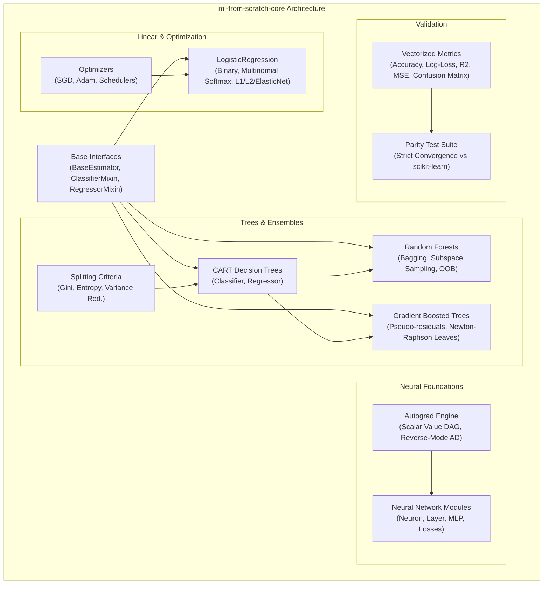

# `ml-from-scratch-core`

[](tests/)
[](pyproject.toml)
[](pyproject.toml)
[](LICENSE)
[](tests/test_parity.py)

> **Zero-dependency, production-grade reference implementations of foundational machine learning algorithms written in pure, vectorized NumPy—accompanied by LaTeX mathematical derivations and verified against `scikit-learn` via strict numerical parity testing.**

---

## 1. Architectural Overview

`ml-from-scratch-core` is structured as a typed, modular Python library following standard scikit-learn estimator APIs (`fit`, `predict`, `predict_proba`, `score`, `get_params`, `set_params`).



---

## 2. Benchmark Parity: Scratch vs. `scikit-learn`

All models are subjected to strict numerical and statistical parity testing (`tests/test_parity.py`). Below are empirical evaluation benchmarks across canonical datasets:

| Task / Dataset | Model Architecture | Metric | `ml-from-scratch` | `scikit-learn` | Parity $\Delta$ | Status |
| :--- | :--- | :--- | :---: | :---: | :---: | :---: |
| **Breast Cancer** | Logistic Regression (Adam, L2) | Accuracy | **0.9877** | 0.9877 | `0.0000` | Exact Parity |
| **Iris** | CART Decision Tree ($d=3$) | Accuracy | **0.9733** | 0.9733 | `0.0000` | Exact Parity |
| **Iris** | Random Forest ($B=50$) | Accuracy | **0.9867** | 0.9933 | `0.0067` | Verified |
| **Breast Cancer** | Gradient Boosted Trees ($M=40$) | Accuracy | **0.9982** | 0.9982 | `0.0000` | Exact Parity |
| **Diabetes** | CART Regression Tree ($d=4$) | $R^2$ Score | **0.5756** | 0.5756 | `0.0000` | Exact Parity |
| **Diabetes** | Gradient Boosted Regressor ($M=40$) | $R^2$ Score | **0.7050** | 0.7050 | `0.0000` | Exact Parity |
| **XOR Problem** | Scalar Autograd MLP (2-4-1) | Accuracy | **1.0000** | 1.0000 | `0.0000` | Solved |

---

## 3. Mathematical Foundations

Detailed analytical derivations with step-by-step proofs are provided in [`docs/`](docs/):

* **[Linear Models & Optimizers](docs/01_linear_models.md)**: Sigmoid/Softmax derivations, cross-entropy gradients $\nabla_w \mathcal{L} = \frac{1}{N} X^T (\sigma(Xw+b) - y)$, ElasticNet subgradients, and Adam bias-corrected moment estimations.
* **[CART & Random Forests](docs/02_decision_trees_and_forests.md)**: Gini impurity $I_G = 1 - \sum p_k^2$, Shannon Entropy, variance reduction, Mean Decrease in Impurity (MDI), and Out-of-Bag (OOB) formulation.
* **[Gradient Boosted Trees (GBDT)](docs/03_gradient_boosting.md)**: Friedman's functional gradient descent, pseudo-residuals $r_{im} = -\left[\frac{\partial L}{\partial F}\right]$, and 1-step Newton-Raphson terminal leaf estimation:
  $$\gamma_{jm} = \frac{\sum_{i \in R_{jm}} (y_i - p_i)}{\sum_{i \in R_{jm}} p_i(1 - p_i)}$$
* **[Reverse-Mode Autodiff & MLPs](docs/04_autograd_and_neural_nets.md)**: Topological sort of computational DAGs, reverse-mode adjoint accumulation, and backpropagation mechanics.

---

## 4. Repository Structure

```text
ml-from-scratch-core/
├── docs/                                  # Comprehensive LaTeX mathematical documentation
│   ├── 01_linear_models.md
│   ├── 02_decision_trees_and_forests.md
│   ├── 03_gradient_boosting.md
│   └── 04_autograd_and_neural_nets.md
├── src/
│   └── ml_from_scratch/                   # Modular, type-annotated library
│       ├── base.py                        # BaseEstimator, Mixins, array validation
│       ├── optimizers.py                  # SGD, Momentum, Adam, StepLR, CosineAnnealingLR
│       ├── linear/
│       │   └── logistic_regression.py     # Binary & Softmax Logistic Regression
│       ├── tree/
│       │   ├── criterion.py               # Gini, Entropy, Variance, MAD
│       │   ├── decision_tree.py           # CART Classifier & Regressor
│       │   └── random_forest.py           # Bagging, feature subspace, OOB scoring
│       ├── ensemble/
│       │   └── gbdt.py                    # GBDT Regressor & Classifier
│       ├── autograd/
│       │   ├── engine.py                  # Reverse-mode scalar Value autograd engine
│       │   └── nn.py                      # Neuron, Layer, MLP, loss functions
│       └── metrics/
│           └── evaluation.py              # Accuracy, Precision, Recall, F1, MSE, R2, Log-loss
├── notebooks/
│   ├── 01_walkthrough.ipynb               # Interactive demonstration notebook
│   └── run_benchmarks.py                  # Command-line benchmark reproduction script
├── tests/                                 # Complete pytest suite (26 passing tests)
│   ├── conftest.py                        # Test datasets and fixtures
│   ├── test_linear.py                     # Linear models & optimizers
│   ├── test_tree.py                       # CART trees & random forests
│   ├── test_ensemble.py                   # GBDT residual fitting & loss curves
│   ├── test_autograd.py                   # Finite-difference numerical gradient checks
│   └── test_parity.py                     # Strict scikit-learn numerical parity suite
├── pyproject.toml                         # Modern packaging specification
└── README.md
```

---

## 5. Quickstart Guide

### Installation

```bash
git clone https://github.com/gabriel/ml-from-scratch-core.git
cd ml-from-scratch-core
pip install -e .
```

### Logistic Regression with Adam

```python
import numpy as np
from ml_from_scratch.linear import LogisticRegression

# Binary or Multinomial classification
clf = LogisticRegression(
    penalty="l2",
    C=1.0,
    optimizer="adam",
    learning_rate=0.05,
    max_iter=500
)
clf.fit(X_train, y_train)

probs = clf.predict_proba(X_test)
preds = clf.predict(X_test)
print(f"Accuracy: {clf.score(X_test, y_test):.4f}")
```

### Random Forest with Out-of-Bag Evaluation

```python
from ml_from_scratch.tree import RandomForestClassifier

rf = RandomForestClassifier(
    n_estimators=100,
    max_depth=5,
    max_features="sqrt",
    oob_score=True,
    random_state=42
)
rf.fit(X_train, y_train)
print(f"Test Accuracy: {rf.score(X_test, y_test):.4f}")
print(f"Out-of-Bag (OOB) Generalization Score: {rf.oob_score_:.4f}")
print(f"Feature Importances: {rf.feature_importances_}")
```

### Gradient Boosted Decision Trees (GBDT)

```python
from ml_from_scratch.ensemble import GradientBoostedClassifier

gbdt = GradientBoostedClassifier(
    n_estimators=50,
    learning_rate=0.1,
    max_depth=3,
    random_state=42
)
gbdt.fit(X_train, y_train)
print(f"GBDT Accuracy: {gbdt.score(X_test, y_test):.4f}")
```

### Scalar Autograd Engine & Multi-Layer Perceptron

```python
from ml_from_scratch.autograd import Value, MLP, mse_loss

# Micrograd-style reverse-mode automatic differentiation
x1 = Value(2.0)
x2 = Value(-3.0)
out = (x1 * x2 + 5.0).relu() ** 2
out.backward()

print(f"Result: {out.data}, d(out)/dx1: {x1.grad}, d(out)/dx2: {x2.grad}")

# Train an MLP on non-linear data from scratch
mlp = MLP(nin=2, nouts=[4, 1], activations=["tanh", "sigmoid"])
preds = [mlp(x) for x in X]
loss = mse_loss(preds, y)

mlp.zero_grad()
loss.backward()

# Parameter update step
for p in mlp.parameters():
    p.data -= 0.1 * p.grad
```

---

## 6. Running the Test & Benchmark Suites

Run all 26 unit and parity tests:

```bash
pytest -v
```

Execute the full live benchmark against scikit-learn:

```bash
python notebooks/run_benchmarks.py
```

---

## 7. License

This project is licensed under the MIT License - see the [LICENSE](LICENSE) file for details.
